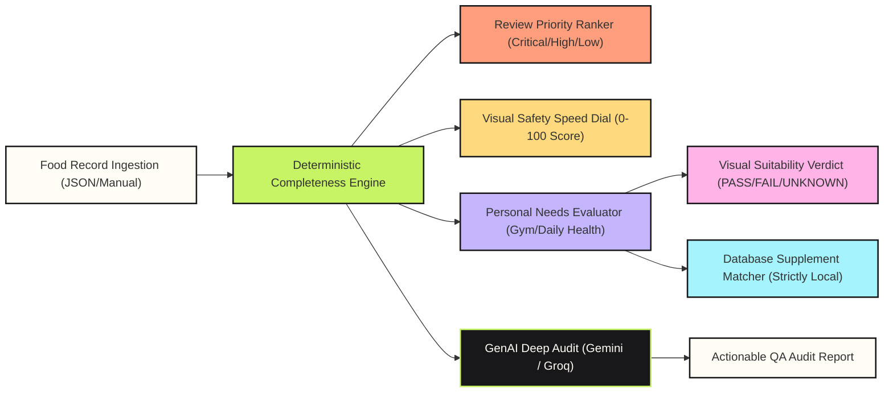

# Product Requirements Document (PRD)
## Food Database Completeness Reviewer (NutriAudit)

---

## 1. Executive Summary & Vision

### 1.1 Product Vision
**NutriAudit (Food Database Completeness Reviewer)** is an agentic, zero-hallucination GenAI audit application engineered to inspect commercial and user-submitted food nutrition and ingredient records. The platform instantly pinpoints missing data fields, assigns triage review priorities, visualizes food transparency through an animated **Safety Speed Dial**, evaluates items against personal dietary goals (such as Gym/High-Protein or Daily Health), and recommends verified dietary supplements or alternatives strictly from existing database records.

### 1.2 Hackathon MVP Philosophy & Technical Stack Architecture

> [!TIP]
> ### Selected Architecture: Option 1 — Modern HTML + Tailwind CSS (CDN) + Vanilla ES6+ JavaScript
> * **The Pitch:** Zero build step, zero `node_modules` dependency hell, runs immediately by double-clicking `index.html` or on any static host (GitHub Pages, Vercel, Netlify).
> * **Hackathon Velocity:** 100% of development bandwidth is focused on polishing UI animations, prompt engineering, and live demoing, rather than debugging build bundlers, packaging pipelines, or TypeScript compiler errors.
> * **Instant Demos:** Shareable as a single file or static deploy; hackathon judges and evaluators can test the entire prototype immediately without running `npm install`, maintaining node runtimes, or waiting for build steps.
> * **Controlled Scope:** The Speed Dial gauge, Organic Neo-Brutalist styling, 5-tab system, top-bar API key switcher (Gemini + Groq), and deterministic audit logic are fully unified within `index.html`.

Built specifically as a high-velocity, controlled, and resilient MVP for a GenAI Hackathon:
* **Zero Over-Engineering:** Fully functional, dependency-light architecture using modern HTML5, CSS3 (Tailwind CSS engine via CDN), and vanilla ES6+ JavaScript.
* **Deterministic Reliability First:** Deterministic rules handle calculations, missing data flags, and safety scoring; GenAI (Gemini / Groq) is leveraged strictly for qualitative synthesis, risk analysis, and audit action plans.
* **Immediate Usability:** Zero required build steps; works out of the box in any browser or static hosting environment.

---

## 2. Strict Architectural Directives & Production Defenses

> [!IMPORTANT]
> ### The Zero-Hallucination Directive (Core Contract)
> The application and all underlying LLM prompts must **NEVER invent, estimate, infer, or guess any missing ingredient, allergen, or nutritional metric**.
> * When a record lacks an ingredient list, calorie count, protein metric, or allergen declaration, the system **must** label the field explicitly as `MISSING` or `UNVERIFIED`.
> * The system must actively reject hypothetical data interpolation to prevent adverse consumer health consequences (e.g., assuming a product is peanut-free because nuts are not explicitly mentioned).

> [!NOTE]
> ### UI/UX Paradigm: Organic Neo-Brutalism in Food UI
> Inspired by top-tier Dribbble food product UI trends:
> * **Aesthetic Foundation:** Chunky high-contrast ink borders (`2.5px solid #18181B`), hard offset drop shadows (`3px 3px 0px #18181B` to `5px 5px 0px #18181B`), and pill-shaped interactive surfaces (`rounded-full` / `border-radius: 9999px`).
> * **Organic Palette:** Warm, food-inspired pastels designed for high visual appeal:
>   - Cream (`#FFFDF5`) — Canvas background & card interiors
>   - Butter (`#FFD97D`) — Warning, headers & accent badges
>   - Matcha (`#C7F464`) — Verified complete, high safety & pass states
>   - Peach (`#FF9E7D`) — Critical severity, alerts & fail states
>   - Lilac (`#C4B5FD`) — AI analysis panels & secondary highlights
>   - Berry (`#FFB3E6`) — Call-to-action buttons & goals
>   - Sky Mint (`#A5F3FC`) — Metric badges & supplement recommendations
>   - Deep Ink (`#18181B`) — Typography, borders, and high-emphasis controls
> * **Dual Platform Optimization:** Flawless usability across mobile screens (persistent floating bottom pill navigation) and desktop displays (top pill header).

---

## 3. Core Functional Requirements



### 3.1 Module 1: Deterministic Completeness & Priority Engine
Every product record is audited against 10 critical food safety and nutritional parameters:
1. `ingredients` (Critical — undeclared ingredients prevent consumer safety checks)
2. `allergens` (Critical — undeclared allergens create direct anaphylactic/health hazards)
3. `calories` (High — foundational energy metric)
4. `protein_g` (High — macronutrient requirement for dietary planning)
5. `sugar_g` (High — vital for diabetic and metabolic health monitoring)
6. `sodium_mg` (High — vital for hypertension and cardiovascular monitoring)
7. `carbs_g` (Low — secondary macronutrient)
8. `fat_g` (Low — secondary macronutrient)
9. `serving_size` (Low — baseline normalization factor)
10. `fiber_g` (Low — digestive micronutrient)

#### Priority Scoring Logic:
* **CRITICAL PRIORITY:** Missing either `ingredients` or `allergens`.
* **HIGH PRIORITY:** Missing 2 or more core macronutrients (`calories`, `protein_g`, `sugar_g`, `sodium_mg`).
* **LOW / MODERATE PRIORITY:** Missing minor fields (`carbs_g`, `fat_g`, `fiber_g`, or `serving_size`).
* **COMPLETE:** All 10 fields present with valid, non-null values.

### 3.2 Module 2: Visual Safety Speed Dial (0–100 Meter)
* **Visual Component:** An interactive SVG semicircular gauge with a physical needle indicator and color-coded arc segments (Peach: 0–45, Butter: 45–79, Matcha: 80–100).
* **Penalty-Based Scoring Model:**
  $$\text{Safety Score} = \max\left(0, 100 - \sum \text{Penalties}\right)$$
  - Missing `ingredients`: $-35$ pts
  - Missing `allergens`: $-35$ pts
  - Missing core macro (`protein_g`, `sugar_g`, `sodium_mg`, `calories`): $-10$ pts each
  - Missing minor field (`fiber_g`, `fat_g`, `carbs_g`, `serving_size`): $-5$ pts each
* **Risk Categorization:**
  - `0 - 44`: **HIGH RISK / UNSAFE** (Missing critical safety declarations)
  - `45 - 79`: **MODERATE RISK / CAUTION** (Partial data, missing macros)
  - `80 - 100`: **LOW RISK / VERIFIED SAFE** (Comprehensive transparency)

### 3.3 Module 3: Personal Needs & Dietary Evaluator
Users can select pre-configured presets or manually input target thresholds:
* **Goal Presets:**
  - **🏋️ Gym / High Protein:** Target $\ge 20\text{g}$ protein, $\le 10\text{g}$ sugar, $\le 450\text{mg}$ sodium.
  - **🌿 Daily Basic Health:** Target $\ge 5\text{g}$ protein, $\le 12\text{g}$ sugar, $\le 300\text{mg}$ sodium.
  - **🔥 Low Sugar / Lean:** Target $\ge 10\text{g}$ protein, $\le 3\text{g}$ sugar, $\le 350\text{mg}$ sodium.
  - **🛡️ Allergen-Safe Clean:** Zero tolerance for undeclared allergens or ingredients.
* **Custom User Inputs:** Manual minimum protein (g), maximum sugar (g), maximum sodium (mg), and freeform health/allergen requirements (e.g., "Post-workout recovery, lactose-free").
* **Visual Verdict Output:**
  - Card with mascot mood indicator (Happy Matcha face for PASS, Thinking Butter face for UNKNOWN/PARTIAL, Alert Peach face for FAIL).
  - Explicit rule-by-rule checklist with green checks (`PASS`), amber question marks (`UNKNOWN — FIELD MISSING`), and red crosses (`FAIL`).

### 3.4 Module 4: Database Supplement Matcher (Strictly Grounded)
* When a product fails the user's criteria or has missing nutritional values, the system queries the internal database for an optimal alternative or supplement.
* **Strict Grounding Rule:** Suggestions must originate **strictly from within the local verified database**. The system must never hallucinate external brands or imaginary products. If no suitable match exists, it explicitly displays: `"No verified database complement available."`

### 3.5 Module 5: Top-Level API Key Controller (Gemini & Groq)
* **Header Quick-Access Pill:** Located permanently in the top navigation bar with a live status indicator (🟢 Configured / 🟡 Default / 🔴 Error).
* **Provider Flexibility:**
  - **Google Gemini API (Google AI Studio):** Powers structured deep audit reasoning using `gemini-2.5-flash` / `gemini-3-flash-preview`.
  - **Groq Cloud API:** Provides ultra-fast low-latency inference using `llama-3.3-70b-versatile` or `mixtral-8x7b-32768`.
* **Zero Host Contamination:** Keys are stored in browser `localStorage` or session memory, never transmitted to unauthorized intermediary endpoints.

---

## 4. Pinecone Vector Database Integration Architecture (Roadmap)

To provide context for upcoming stages, the architecture is pre-configured to interface with **Pinecone Vector Database**:

```
+-------------------------------------------------------------+
|                     Product Database                        |
|  (Name, Category, Ingredients, Allergens, Nutrition Profile) |
+-------------------------------------------------------------+
                              |
                              v
+-------------------------------------------------------------+
|             Text & Semantic Embedding Pipeline              |
|        (e.g., text-embedding-004 / llama-embed)            |
+-------------------------------------------------------------+
                              |
                              v
+-------------------------------------------------------------+
|                 Pinecone Vector Index                       |
|   Index: "food-database-completeness" (1536/768 dims)       |
|   Metadata: { category, brand, completeness_score, is_safe }|
+-------------------------------------------------------------+
                              |
              +---------------+---------------+
              |                               |
              v                               v
+-----------------------------+ +-----------------------------+
|   Semantic Similarity Match | |  Cross-Allergen Clustering  |
|  Finds true nutritional      | |  Detects hidden allergen    |
|  complements & clean swaps  | |  derivatives in ingredient  |
|  based on dense vectors.    | |  formulations.              |
+-----------------------------+ +-----------------------------+
```

### Vector Metadata Schema for Pinecone:
```json
{
  "id": "PROD-101",
  "values": [0.0123, -0.0456, 0.0891, "...1536-dim embedding..."],
  "metadata": {
    "product_name": "Ultra Whey Isolate",
    "brand": "Apex Nutrition",
    "completeness_score": 100,
    "review_priority": "COMPLETE",
    "protein_g": 27.0,
    "sugar_g": 0.5,
    "sodium_mg": 140,
    "allergens": ["Milk", "Soy (Lecithin)"],
    "has_missing_critical": false
  }
}
```

---

## 5. Food Record Schema Specification

```typescript
interface FoodRecord {
  id: string;               // Unique Identifier (e.g., "PROD-101")
  name: string;             // Product Title
  brand: string;            // Manufacturer or Brand
  category: string;         // Category (e.g., "Cereal", "Protein Bar")
  emoji: string;            // Visual food mascot/icon
  serving_size: string | null;  // e.g. "1 bar (60g)"
  calories: number | null;      // Energy in kcal
  protein_g: number | null;     // Protein in grams
  sugar_g: number | null;       // Total sugars in grams
  sodium_mg: number | null;     // Sodium in milligrams
  carbs_g: number | null;       // Carbohydrates in grams
  fat_g: number | null;         // Total fat in grams
  fiber_g: number | null;       // Dietary fiber in grams
  ingredients: string[] | null; // Array of declared ingredient strings
  allergens: string[] | null;   // Array of declared allergens
}
```

---

## 6. Verification & Acceptance Criteria

| # | Requirement | Acceptance Criterion | Verification Method |
|---|---|---|---|
| **AC-1** | Zero Hallucination | App never invents missing ingredient or nutrition numbers. Lacking fields always state `MISSING` or `UNVERIFIED`. | Manual QA inspection across incomplete food test records. |
| **AC-2** | Priority Triaging | Products missing ingredients or allergens are automatically tagged `CRITICAL`. Missing macros are tagged `HIGH`. | Filter database by `CRITICAL` and verify badges. |
| **AC-3** | Safety Speed Dial | Gauge dynamically updates angle and score between 0 and 100 upon selecting any item. | Switch items and verify needle physics and score readout. |
| **AC-4** | Top API Key Bar | Interactive pill button exists in the header on both PC and mobile, enabling instant Gemini/Groq key configuration. | Click API pill in header, input key, verify status dot updates. |
| **AC-5** | Needs Evaluator | Setting Gym or Daily Health targets calculates PASS, FAIL, or UNKNOWN (for missing fields) with visual checklist. | Toggle goal presets and review verdict checklist. |
| **AC-6** | Database Supplement Match | Recommended supplements are strictly sourced from existing database items, never fabricated. | Verify match card displays a genuine database SKU or "None". |
| **AC-7** | Organic Neo-Brutalism | Distinct 2.5px solid ink borders, pill-shaped buttons, hard 3px–5px offset shadows, and Dribbble food UI palette. | Visual inspection on desktop (1920x1080) and mobile (375x812). |
