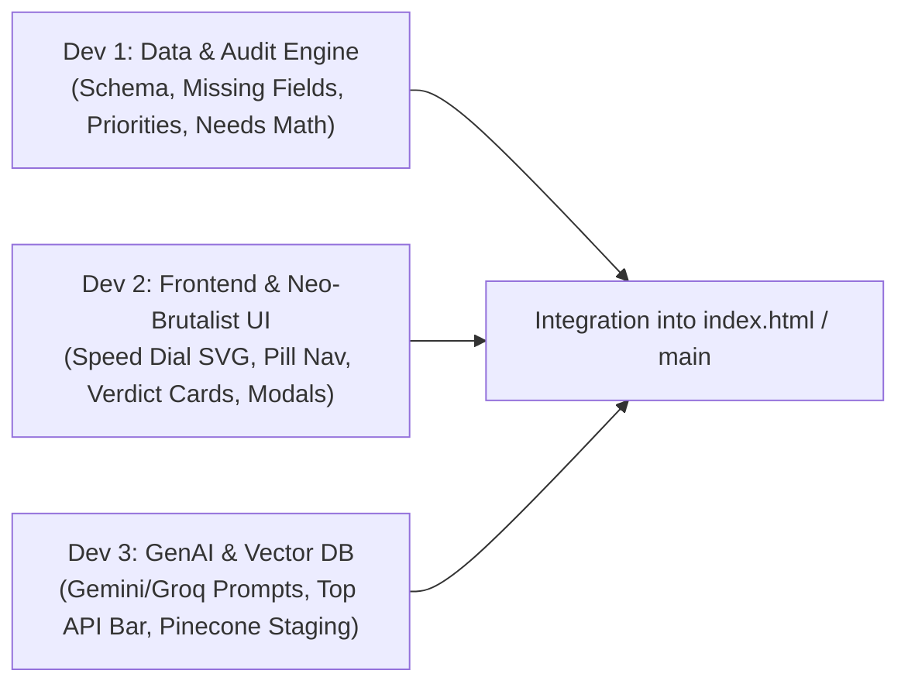

# Team Work Plan: Food Database Completeness Reviewer (3-Dev Split)

## 1. Problem Statement
> **Food Database Completeness Reviewer:**
> Develop a GenAI application that processes product nutrition and ingredient records. The system should produce a list of incomplete fields and review priorities. **The prototype must never invent missing ingredient values.**

---

## 2. Non-Negotiable Core Rules (All 3 Devs)
1. **Zero-Hallucination Contract:** Never guess, estimate, or synthesize missing nutrition, ingredient, or allergen values. Any `null`, `undefined`, `""`, or `[]` field **must** be flagged explicitly as `MISSING` or `UNVERIFIED`.
2. **Design System:** Organic Neo-Brutalism (Dribbble food UI aesthetic) — pill-shaped controls (`rounded-full`), chunky `2.5px solid #18181B` borders, hard offset drop shadows (`3px`–`5px`), and warm organic pastels (`Cream #FFFDF5`, `Butter #FFD97D`, `Matcha #C7F464`, `Peach #FF9E7D`, `Lilac #C4B5FD`, `Berry #FFB3E6`, `Sky Mint #A5F3FC`).
3. **Keep It Simple (Hackathon MVP):** No over-engineering. Use the existing vanilla HTML/CSS/JS setup in `index.html` and keep functions clean, deterministic, and easy to demo.
4. **Commit Convention:** Use Conventional Commits (`feat(scope): ...`, `fix(scope): ...`, `docs(scope): ...`).

---

## 3. Shared Data Contract (`FoodRecord`)
All 3 developers must agree on this exact JSON structure for product records:

```json
{
  "id": "PROD-101",
  "name": "NitroBlast Whey Crunch Bar",
  "brand": "IronPulse Labs",
  "category": "Protein Snack",
  "emoji": "🍫",
  "serving_size": "60g bar",
  "calories": 240,
  "protein_g": 22,
  "carbs_g": 21,
  "sugar_g": null,
  "fat_g": 8,
  "fiber_g": 4,
  "sodium_mg": null,
  "ingredients": null,
  "allergens": null
}
```
*Any missing field MUST remain `null` (or `[]` / `""`), never filled with a placeholder number.*

---

## 4. Division of Work (3 Developers)



| Developer | Role Title | Individual Brief | Primary Files / Sections |
|---|---|---|---|
| **Dev 1** | Data & Deterministic Audit Lead | [DEV1_AUDIT_ENGINE.md](docs/DEV1_AUDIT_ENGINE.md) | `REQUIRED_FIELDS`, `foodDatabase`, `auditProduct()`, `evaluateUserNeeds()`, `renderDatabaseSupplement()`, Add Record parser |
| **Dev 2** | Organic Neo-Brutalist UI/UX Lead | [DEV2_FRONTEND_UI.md](docs/DEV2_FRONTEND_UI.md) | Tailwind theme, CSS classes, PC/Mobile Pill Nav, SVG Safety Speed Dial, Visual Verdict & Checklist UI, Add Record Modal |
| **Dev 3** | GenAI & Vector Integration Lead | [DEV3_GENAI_PINECONE.md](docs/DEV3_GENAI_PINECONE.md) | Top-Header API Key Modal & Sync, `callGeminiWithBackoff()`, `callGroqWithBackoff()`, Zero-Hallucination Prompt, `.env.example` & Pinecone Staging |

---

## 5. Git Branching & Integration Workflow
1. **Branch Naming:**
   - Dev 1: `feat/dev1-audit-engine`
   - Dev 2: `feat/dev2-neobrutalist-ui`
   - Dev 3: `feat/dev3-genai-pinecone`
2. **Sync Checkpoints:**
   - **Checkpoint 1 (Schema Lock):** Dev 1 finalizes `FoodRecord` fields and `auditProduct()` return shape so Dev 2 and Dev 3 can bind to exact keys (`safetyScore`, `priority`, `missingFields`, `completenessPct`).
   - **Checkpoint 2 (UI + Logic Bind):** Dev 2 wires DOM IDs to Dev 1's functions and exposes `#gemini-output-content` + `#api-key-modal` for Dev 3.
   - **Checkpoint 3 (End-to-End Demo Test):** Test with an incomplete product (missing `ingredients` + `allergens`), verify Speed Dial drops, verify `UNKNOWN` / `MISSING` badges, run Gemini/Groq Deep Audit, and confirm zero hallucinated values.
